# Diagrama de classes

Diagrama UML do estado atual do código (**código final: combatentes, habilidades, itens, combate, interface de console e fluxo do jogo**). É atualizado a cada etapa. O GitHub renderiza o bloco Mermaid abaixo automaticamente.

```mermaid
classDiagram
    direction TB

    %% ===== pacote rpg.combatentes =====
    class Combatente {
        <<abstract>>
        -String nome
        -int vidaMaxima
        -int vida
        -int ataque
        -int defesa
        +receberDano(int dano) int
        +curar(int quantidade) void
        +estaVivo() boolean
        +falar() String
        +getAtaque() int
        +getDefesa() int
    }
    class Personagem {
        <<abstract>>
        +usarItem(Usavel item) String
        +equipar(Equipavel item) String
        +getAtaque() int
        +getDefesa() int
    }
    class Inimigo {
        <<abstract>>
        +escolherAcao(List~Personagem~ heroisVivos) Acao
    }
    class Duelista
    class Feiticeira
    class Espiao
    class Soldado
    class Madoc

    Combatente <|-- Personagem
    Combatente <|-- Inimigo
    Personagem <|-- Duelista
    Personagem <|-- Feiticeira
    Personagem <|-- Espiao
    Inimigo <|-- Soldado
    Inimigo <|-- Madoc

    %% ===== pacote rpg.habilidades =====
    class Habilidade {
        <<interface>>
        +getNome() String
        +getUsosRestantes() int
        +podeUsar() boolean
        +precisaDeAlvo() boolean
        +usar(Combatente usuario, Combatente oponente) String
    }
    class HabilidadeLimitada {
        <<abstract>>
        -String nome
        -int usosRestantes
        +usar(Combatente usuario, Combatente oponente) String
        #aplicarEfeito(Combatente usuario, Combatente oponente) String
    }
    class GolpeCerteiro
    class GlamourRestaurador
    class GolpeFurtivo

    Habilidade <|.. HabilidadeLimitada
    HabilidadeLimitada <|-- GolpeCerteiro
    HabilidadeLimitada <|-- GlamourRestaurador
    HabilidadeLimitada <|-- GolpeFurtivo
    Personagem --> Habilidade : possui 1
    Habilidade ..> Combatente : age sobre

    %% ===== pacote rpg.itens =====
    class Item {
        <<interface>>
        +getNome() String
        +getDescricao() String
    }
    class Usavel {
        <<interface>>
        +usar(Combatente alvo) String
    }
    class Equipavel {
        <<interface>>
        +getSlot() SlotEquipamento
        +getBonusAtaque() int
        +getBonusDefesa() int
    }
    class SlotEquipamento {
        <<enumeration>>
        ARMA
        ARMADURA
    }
    class ItemBase {
        <<abstract>>
        -String nome
        -String descricao
    }
    class PocaoDeCura {
        -int cura
    }
    class Arma {
        -int bonusAtaque
    }
    class Armadura {
        -int bonusDefesa
    }
    class Inventario {
        +adicionar(Item item) void
        +remover(Item item) boolean
        +getItens() List~Item~
        +getUsaveis() List~Usavel~
        +getEquipaveis() List~Equipavel~
    }
    class Equipamentos {
        +equipar(Equipavel e) Optional~Equipavel~
        +getBonusAtaque() int
        +getBonusDefesa() int
    }

    Item <|-- Usavel
    Item <|-- Equipavel
    Item <|.. ItemBase
    ItemBase <|-- PocaoDeCura
    ItemBase <|-- Arma
    ItemBase <|-- Armadura
    Usavel <|.. PocaoDeCura
    Equipavel <|.. Arma
    Equipavel <|.. Armadura
    Equipavel --> SlotEquipamento
    Personagem *-- Inventario
    Personagem *-- Equipamentos
    Inventario o-- Item : guarda 0..*
    Equipamentos o-- Equipavel : veste 0..*
    Usavel ..> Combatente : age sobre

    %% ===== pacote rpg.combate =====
    class Acao {
        <<interface>>
        +executar() String
    }
    class AtaqueBasico
    class GolpeBrutal
    class UsarHabilidade
    class UsarItem
    class EquiparItem
    class EstrategiaDeAcao {
        <<interface>>
        +escolher(Inimigo inimigo, List~Personagem~ heroisVivos) Acao
    }
    class EstrategiaAgressiva
    class EstrategiaDoChefe
    class EntradaDoJogador {
        <<interface>>
        +escolherAcao(Personagem heroi, List~Inimigo~ inimigosVivos) Acao
    }
    class SaidaDoJogo {
        <<interface>>
        +exibir(String mensagem) void
        +exibirEstado(List~Personagem~ herois, List~Inimigo~ inimigos) void
    }
    class ResultadoCombate {
        <<enumeration>>
        VITORIA
        DERROTA
    }
    class Batalha {
        <<interface>>
        +executar() ResultadoCombate
    }
    class FabricaDeBatalha {
        <<interface>>
        +criar(List~Personagem~ herois, List~Inimigo~ inimigos) Batalha
    }
    class Combate {
        +executar() ResultadoCombate
    }
    class FabricaDeCombate

    Acao <|.. AtaqueBasico
    Acao <|.. GolpeBrutal
    Acao <|.. UsarHabilidade
    Acao <|.. UsarItem
    Acao <|.. EquiparItem
    EstrategiaDeAcao <|.. EstrategiaAgressiva
    EstrategiaAgressiva <|-- EstrategiaDoChefe
    EstrategiaDeAcao ..> Acao : cria
    EntradaDoJogador ..> Acao : devolve
    Inimigo --> EstrategiaDeAcao : usa 1
    Batalha <|.. Combate
    FabricaDeBatalha <|.. FabricaDeCombate
    FabricaDeBatalha ..> Batalha : cria
    FabricaDeCombate ..> Combate : cria
    FabricaDeCombate --> EntradaDoJogador
    FabricaDeCombate --> SaidaDoJogo
    Combate --> EntradaDoJogador
    Combate --> SaidaDoJogo
    Combate --> "1..*" Personagem
    Combate --> "1..*" Inimigo
    Combate ..> Acao : executa
    Combate ..> ResultadoCombate


    %% ===== pacotes rpg.jogo e rpg.historia =====
    class DecisoesDaJornada {
        <<interface>>
        +escolherHeroi(List~Personagem~ opcoes) Personagem
        +prepararParaBatalha(Personagem heroi) void
    }
    class Fase {
        -String titulo
        -String introducao
        -String conclusao
    }
    class Campanha {
        -String titulo
        -String prologo
        -String finalDeVitoria
        -String finalDeDerrota
    }
    class Jogo {
        +jogar(List~Personagem~ herois, Campanha campanha) void
    }
    class FabricaDeHerois {
        +criarHerois() List~Personagem~
    }
    class RoteiroDoPrincipeCruel {
        +criarCampanha() Campanha
    }

    Campanha *-- "1..*" Fase
    Fase o-- "1..*" Inimigo : enfrenta
    Fase o-- Item : recompensas 0..*
    Jogo --> DecisoesDaJornada
    Jogo --> SaidaDoJogo
    Jogo --> FabricaDeBatalha
    Jogo ..> Campanha : conduz
    FabricaDeHerois ..> Personagem : cria
    RoteiroDoPrincipeCruel ..> Campanha : cria

    %% ===== pacote rpg.ui =====
    class Console {
        -Scanner teclado
        -PrintStream tela
    }
    EntradaDoJogador <|.. Console
    SaidaDoJogo <|.. Console
    DecisoesDaJornada <|.. Console
```

## Próximas atualizações

- Opcional: exportar este diagrama como imagem (por exemplo em mermaid.live) e salvar em `docs/img/diagrama-classes.png`.
