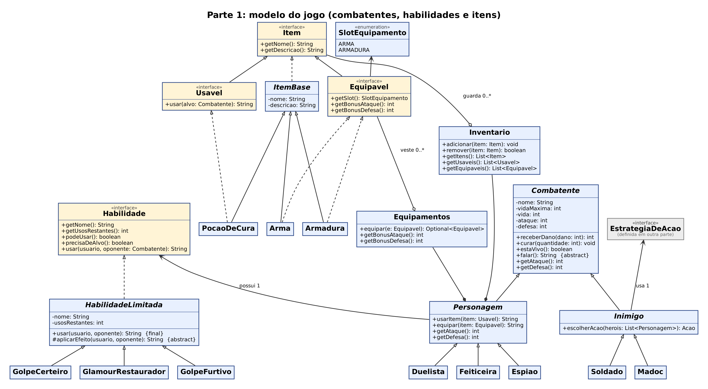
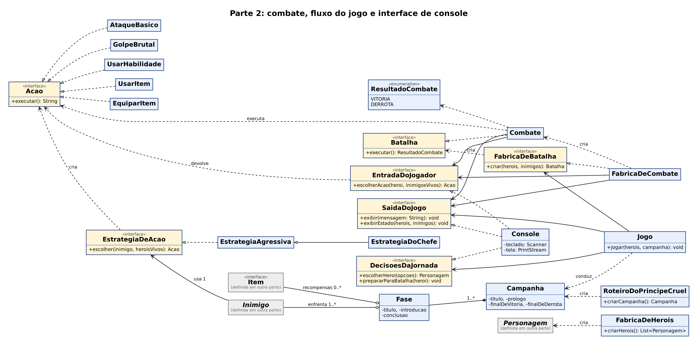
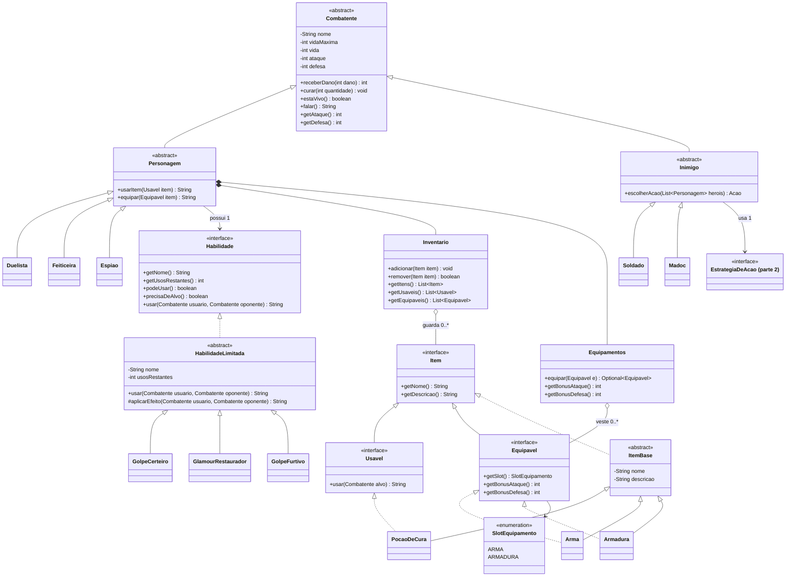
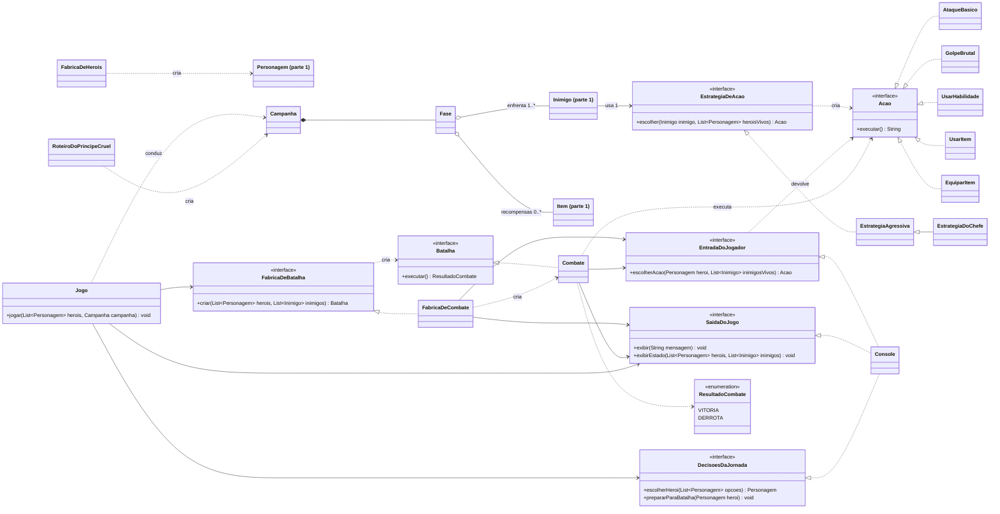

# Diagrama de classes

O diagrama UML foi dividido em **duas partes** para ficar legível. Clique na imagem para ampliar. Cada parte também existe em SVG (imagem vetorial, que amplia sem perder qualidade): [parte 1](img/diagrama-parte1.svg) e [parte 2](img/diagrama-parte2.svg).

As caixas cinzas, nomeadas como "definida em outra parte", são classes que aparecem completas na outra parte do diagrama.

## Parte 1: modelo do jogo (combatentes, habilidades e itens)

## Parte 2: combate, fluxo do jogo e interface de console

## Legenda

| Símbolo | Significado |
|---|---|
| Seta com ponta vazada e linha cheia | Herança (a seta aponta para a classe-pai) |
| Seta com ponta vazada e linha tracejada | Implementação de interface |
| Linha com losango preenchido | Composição (o todo é dono da parte) |
| Linha com losango vazio | Agregação (o todo guarda a parte) |
| Seta simples com linha cheia | Associação (usa por atributo) |
| Seta simples com linha tracejada | Dependência (usa em um método) |
| Nome em itálico | Classe abstrata |

## Versão em texto (Mermaid)

O código abaixo gera os mesmos diagramas no GitHub (o desenho automático é menos organizado que as imagens acima).

Parte 1 em Mermaid

Parte 2 em Mermaid

